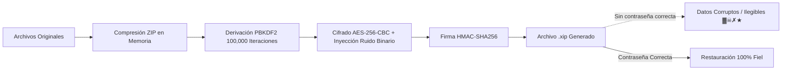

# <p align="center"><br><b>.Xip</b></p>

<p align="center">
  <b>El compresor y cifrador de archivos moderno con alma clásica.</b><br>
  <i>Inspirado en la era dorada del software de compresión, potenciado con criptografía AES-256.</i>
</p>

<p align="center">
  <a href="https://github.com/Fluxzy/Xip/releases"></a>
  
  
  
  
</p>

---

## 🕊️ ¿Qué es .Xip?

**.Xip** es una suite completa de compresión y descompresión de archivos para Windows pensada para ser el sustituto definitivo, libre y gratuito a herramientas clásicas como WinRAR o 7-Zip.

A diferencia de los compresores comunes, **.Xip** introduce el formato nativo `.xip`: una capa de criptografía fuerte que no solo encripta, sino que **corrompe visualmente la estructura binaria expuesta** del contenedor con signos extraños, jeroglíficos y caracteres corruptos. Quien intente inspeccionar o forzar el archivo sin la contraseña solo verá datos destruidos e ilegibles. Solo al proporcionar la clave secreta correcta, los archivos originales se restauran a la perfección con integridad garantizada.

---

## ✨ Características Principales

* 🔒 **Tecnología Criptográfica .Xip (AES-256-CBC + PBKDF2 100k rounds):**
  * Sal aleatoria de 256 bits única por archivo.
  * Autenticación HMAC-SHA256 contra modificaciones accidentales o ataques.
  * Inyección de ruido visual y corrupción de encabezados para despistar análisis forenses básicos.
* 📦 **Soporte Multi-Formato Universal:**
  * **Creación y Extracción:** `.xip`, `.zip`, `.7z`, `.tar`, `.tar.gz`, `.tar.bz2`, `.tar.xz`, `.gz`, `.bz2`, `.xz`.
  * **Extracción:** `.rar` (todos los formatos estándar).
* 🖱️ **Integración Total con el Explorador de Windows:**
  * Menú contextual de clic derecho en cualquier archivo o carpeta:
    * 📦 *Comprimir con .Xip*
    * 🔒 *Comprimir como XIP (cifrado militar)*
    * 📂 *Extraer aquí con .Xip*
  * Acceso directo en el escritorio y fondo de carpetas con el icono de la **Paloma Blanca de la Paz**.
* 🕊️ **Identidad Visual Única:**
  * Icono vectorial/rasterizado de alta resolución con la paloma de la paz blanca.
  * Interfaz gráfica oscura, moderna, responsiva y con árbol de archivos y vista previa.
* ⚡ **Procesamiento Asíncrono Multi-hilo:**
  * Operaciones pesadas en segundo plano con barra de estado y medidor de progreso en tiempo real.

---

## 🖥️ Captura de la Interfaz

```
+-------------------------------------------------------------------------+
| 🕊️  .Xip — Compresor y Cifrador de Archivos                     ─  □  ✕  |
+-------------------------------------------------------------------------+
| [📂 Abrir] [📦 Comprimir] [📤 Extraer] [🔒 Cifrar] [🔓 Descifrar]      |
| Ruta: C:\MisDocumentos\ArchivosSecretos.xip                             |
+-------------------+-----------------------------------------------------+
| 🕊️ .Xip          | Nombre              Tamaño     Comprimido  Ratio    |
|                   |-----------------------------------------------------|
| [📂 Abrir]        | 📄 balance_2026.pdf 4.2 MB     1.1 MB      73%      |
| [📦 Comprimir]    | 🖼️ foto_privada.png 12.8 MB    8.5 MB      33%      |
| [🔒 Cifrar XIP]   | 🔑 contraseñas.kdbx 120 KB     45 KB       62%      |
| [🔓 Descifrar]    |                                                     |
+-------------------+-----------------------------------------------------+
| Listo | 3 archivos en el contenedor                  ██████████ 100%    |
+-------------------------------------------------------------------------+
```

---

## 🚀 Instalación y Uso Rápido

### Método 1: Instalador Ejecutable `.exe` (Recomendado)
Descarga el ejecutable desde la sección de [Releases](https://github.com/Fluxzy/Xip/releases) o compila el tuyo con un clic:
1. Descarga `XipSetup.exe`.
2. Ejecútalo como Administrador para registrar las extensiones y el menú de clic derecho.
3. ¡Listo! Ya puedes hacer clic derecho en cualquier archivo para comprimir o cifrar.

### Método 2: Instalación Portable / Desde Código Fuente
Requisitos: **Python 3.10 o superior**

```bash
# 1. Clonar el repositorio
git clone https://github.com/Fluxzy/Xip.git
cd Xip

# 2. Instalar dependencias
pip install -r requirements.txt

# 3. Iniciar la aplicación
python xip_launcher.py
```

O simplemente haz doble clic en `install.bat` (instalación guiada con dependencias y accesos directos).

---

## 🔐 ¿Cómo Funciona la Criptografía .XIP?



Cualquier intento de abrir el binario sin el algoritmo y la clave correcta produce secuencias de bytes desordenadas y strings corruptos intencionales generados en la capa de cabecera visual.

---

## 🌐 Sitio Web Oficial (Estética Retro 2000s)

El proyecto incluye su propia landing page interactiva con estética nostálgica de los años 2000s inspirada en sitios clásicos de software freeware:
* **Ubicación local:** `website/index.html`
* Fondos de estrellas animados, contadores estilo marcador digital, marquesinas clásicas y botones de descarga 3D biselados.

Para visualizar la web:
```bash
# Puedes abrir el archivo directamente en cualquier navegador o servirlo:
start website/index.html
```

---

## 🛠️ Tecnologías Empleadas

* **Lenguaje:** Python 3 (Tkinter moderno con estilos clam oscuros customizados).
* **Seguridad:** `cryptography` (Primitives AES, PKCS7, PBKDF2HMAC).
* **Formatos:** `py7zr`, `zipfile`, `tarfile`, `gzip`, `bz2`, `lzma`, `rarfile`.
* **Imágenes e Iconografía:** `Pillow` (PIL) para renderizado vectorial del icono.
* **Integración OS:** `winreg` y Windows Shell API (ctypes).

---

## 📄 Licencia

Este proyecto está bajo la Licencia **MIT**. Consulta el archivo `LICENSE` para más detalles.

<p align="center">Hecho con 🕊️ para proteger la privacidad y la libertad digital.</p>
